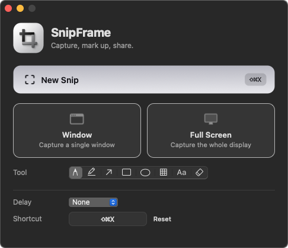
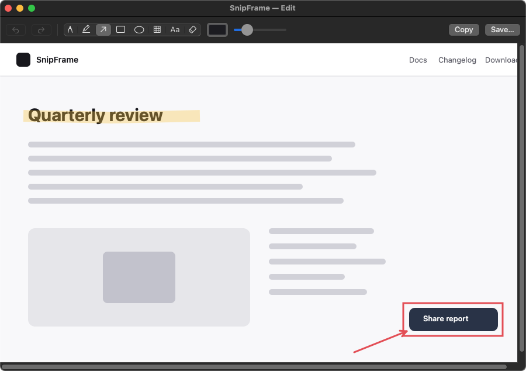

# SnipFrame

The macOS answer to Windows **Snipping Tool**: a native Swift/AppKit app that lives in the menu
bar, captures a region, a window or the whole screen with a global shortcut, and lets you draw on
the result before copying it to the clipboard or saving it as a PNG.

Repository: <https://github.com/chnozmn-pixel/SnipFrame>

No third-party dependencies; only Apple frameworks (AppKit, CoreGraphics, Carbon).

## Screenshots

| Main window | Annotation editor |
| --- | --- |
|  |  |

## Install

1. Download `SnipFrame-1.1.0-macOS.zip` from
   [Releases](https://github.com/chnozmn-pixel/SnipFrame/releases/latest), unzip it and move
   `SnipFrame.app` to `/Applications`.
2. Clear the quarantine flag once (see [First launch](#first-launch-is-blocked-by-gatekeeper))
   or right-click the app → **Open**.
3. Grant Screen Recording permission on the first capture.

With Homebrew (the project's own tap, not `homebrew/cask`):

```bash
brew install --cask chnozmn-pixel/snipframe/snipframe
```

## Features

| Feature | Description |
| --- | --- |
| Region capture | The screen dims; a loupe and pixel-size readout follow the selection |
| Window capture | The window under the cursor is highlighted live and cropped on click |
| Full screen | Captures the display the cursor is on, immediately |
| Delay | 0 / 3 / 5 seconds (from the menu) |
| Multiple displays | Selection happens on the display with the cursor; native pixel quality on Retina |
| Annotation | Pen, highlighter, arrow, rectangle, ellipse, mosaic (redaction), text |
| Eraser | Splits strokes where it touches them; removes shapes, text and mosaic blocks (one undo step) |
| Color & width | Color well plus a line-width slider |
| Tool picker | Pick the default annotation tool in the main window; the editor opens with it |
| Theme | Neutral graphite/silver palette that matches the logo and adapts to light and dark mode |
| Undo / redo | Toolbar buttons and ⌘Z / ⇧⌘Z; while typing, the text field's own history is used |
| Output | ⌘C copies to the clipboard, ⌘S saves a PNG (Desktop by default) |
| Main window | Opens from the Dock icon: gradient “New Snip” button, Window / Full Screen cards, delay picker |
| App icon | Generated from `Resources/AppIconSource.png`; `swift scripts/make-icon.swift` → `AppIcon.icns` + `AppGlyph.png` |
| Background | Keeps running in the menu bar; the shortcut works even when the main window is closed |

## Languages

The interface follows the **system language**. Bundled languages: English, Turkish, German, French
and Spanish (`Resources/<language>.lproj/Localizable.strings`). To add a language, create another
`.lproj` folder with the same keys and repackage with `scripts/build-app.sh`.

## Shortcut

The default is **⌘⇧X**. Click the **Shortcut** field in the main window and press a new
combination to change it; **Reset** restores the default. The choice is stored in `UserDefaults`
(`com.local.snipframe`). A combination must include ⌘, ⌥ or ⌃ (function keys excepted).

## Build

Requirements: macOS 13+, Xcode Command Line Tools (Swift 5.9+).
`scripts/build-app.sh` produces a universal app (Apple Silicon + Intel), so the same
bundle runs natively on both.

```bash
./scripts/build-app.sh          # produces build/SnipFrame.app
open build/SnipFrame.app        # launches the app
```

> You can move the app into `/Applications`. When the ad-hoc signature changes after a rebuild,
> macOS may ask for Screen Recording permission again; that is expected.

### First launch is blocked by Gatekeeper

SnipFrame is signed ad-hoc (no paid Apple Developer ID), so a downloaded copy triggers
“cannot be opened because it is from an unidentified developer”. The app is not damaged; clear
the quarantine flag once and it opens normally afterwards:

```bash
# option 1 — Finder: right-click SnipFrame.app → Open → Open
# option 2 — Terminal (after moving the app to /Applications):
xattr -dr com.apple.quarantine /Applications/SnipFrame.app
open /Applications/SnipFrame.app
```

On macOS 15 and later, if right-click → Open is not offered, use
**System Settings → Privacy & Security → Open Anyway** right after the blocked attempt.

> Downloading with `curl` instead of a browser skips the quarantine flag entirely:
> `curl -L -o SnipFrame.zip https://github.com/chnozmn-pixel/SnipFrame/releases/latest/download/SnipFrame-1.1.0-macOS.zip`

To remove the warning for everyone, the app has to be signed with a Developer ID certificate and
notarized by Apple.

### Screen Recording permission

The first capture triggers a macOS permission prompt. If you deny it or miss it:

Open **System Settings → Privacy & Security → Screen Recording → SnipFrame**, then quit and
relaunch the app.

## Usage

- Click the **SnipFrame** icon in the Dock (or the **viewfinder** icon in the menu bar) and choose
  **Region / Window / Full Screen**, or press **⌘⇧X** from anywhere to start a region selection.
  Clicking the Dock icon brings the main window back when it is closed.
- Region mode: drag and release → the editor opens. `Esc` cancels, `Enter` confirms.
- Window mode: hover the window you want and click.
- In the editor: pick a tool and draw; `⌘C` copies, `⌘S` saves, `⌘Z` undoes, `Esc` closes.
  With the text tool, click, type and press `Enter` to place the text.

## Windows

A Windows port lives in `windows/` — the same capture → annotate → copy flow, written in C# / WPF
on .NET 8. It ships as a portable single-file executable (no installer, no .NET runtime needed).

### Install (Windows 10/11)

1. Download `SnipFrame-1.1.0-windows-x64.zip` from
   [Releases](https://github.com/chnozmn-pixel/SnipFrame/releases/latest) and unzip it anywhere.
2. Run `SnipFrame.exe`. SmartScreen may warn on the first run because the binary is unsigned —
   choose **More info → Run anyway**.
3. Press **Ctrl+Shift+X** from anywhere, or use the tray icon.

### Build

With the .NET 8 SDK installed:

```powershell
cd windows
.\build.ps1                              # -> windows/dist/SnipFrame.exe
dotnet run --project SnipFrame.Windows    # or run straight from source
```

Cross-building from macOS/Linux works as well (the release artifact was produced that way):

```bash
dotnet publish windows/SnipFrame.Windows -c Release -r win-x64 --self-contained true \
  -p:PublishSingleFile=true -p:IncludeNativeLibrariesForSelfExtract=true \
  -p:EnableCompressionInSingleFile=true -o windows/dist
# Turkish UI strings live in a satellite assembly that single-file publish leaves beside the exe
mkdir -p windows/dist/tr && cp windows/SnipFrame.Windows/bin/Release/net8.0-windows/win-x64/tr/SnipFrame.resources.dll windows/dist/tr/
```

### Windows feature set

- Region, window and full-screen capture with a 0 / 3 / 5 second delay
- The same editor: pen, highlighter, arrow, rectangle, ellipse, mosaic, text and eraser, with
  undo/redo (Ctrl+Z / Ctrl+Y), Ctrl+C to the clipboard and Ctrl+S to save a PNG
- Tray icon, global hotkey with a recorder in the main window, default tool picker
- English and Turkish UI (`Strings.resx` + `Strings.tr.resx`), remembered in `%AppData%\SnipFrame\settings.json`

## Project layout

```
Package.swift                       SwiftPM package (macOS 13+)
Resources/Info.plist                Info.plist for the .app bundle
Resources/AppIconSource.png         logo source
Resources/AppIcon.icns              app icon (generated by script)
Resources/AppGlyph.png              main-window badge (generated by script)
Resources/*.lproj                   localization files (en, tr, de, fr, es)
scripts/build-app.sh                build + .app assembly + ad-hoc signing
Sources/SnipFrame/
  main.swift                        app entry point (regular policy — Dock icon)
  AppDelegate.swift                 main window, menu bar item, shortcut, flows, permissions
  MainWindowController.swift        main-window layout (header, actions, tools, delay)
  Controls.swift                    custom-drawn button/card components + brand palette
  Localization.swift                L() helper (system language)
  Shortcut.swift                    shortcut model, key names, UserDefaults
  ShortcutRecorderButton.swift      shortcut recorder field
  HotkeyManager.swift               Carbon global shortcut
  ScreenCaptureService.swift        screen capture + TCC permission helpers
  CaptureOverlay.swift              dimming, region/window selection, loupe
  EditorWindowController.swift      editor window, toolbar, copy/save
  EditorCanvasView.swift            canvas, drawing input, text, undo, export
  CanvasRenderer.swift              annotation model + shared drawing engine
  CanvasContainerView.swift         flipped container for scrolling
windows/                            Windows port (C# / WPF, .NET 8)
docs/screenshots/                   README screenshots
LICENSE                             MIT license
```

## Known limitations

- No free-form (lasso) selection and no video recording — see the roadmap in `PLAN.md`.
- The app is ad-hoc signed, so Gatekeeper may warn on first launch.

## License

MIT — see [LICENSE](LICENSE).
